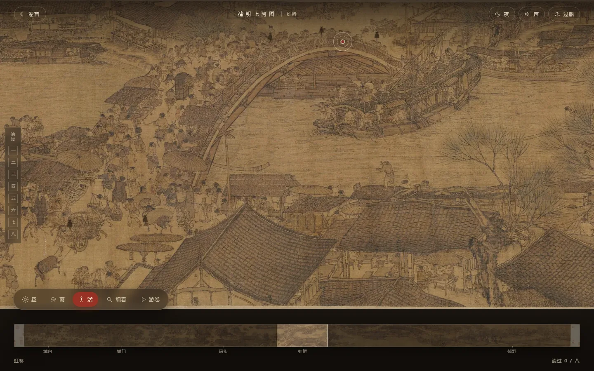
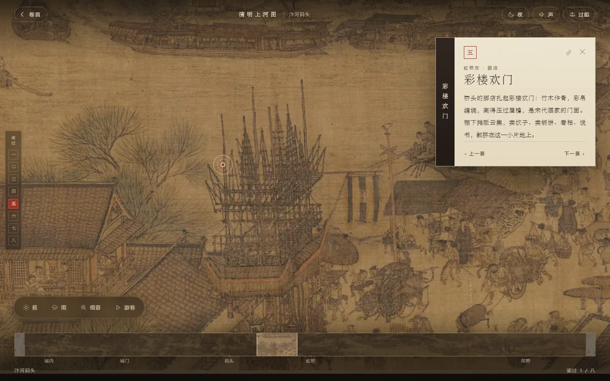
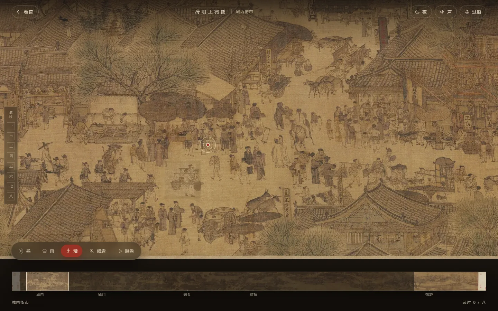
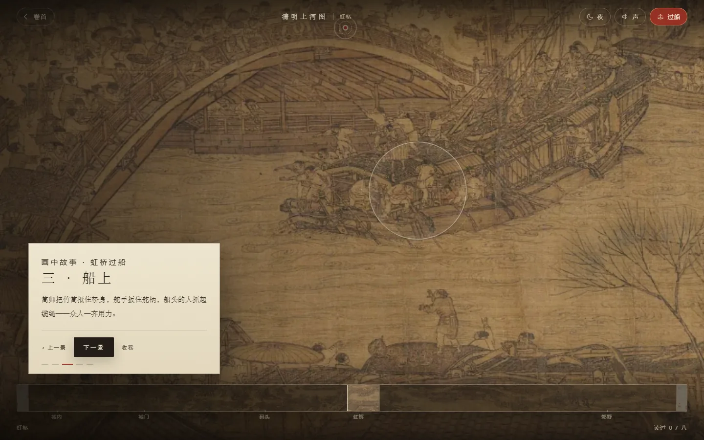
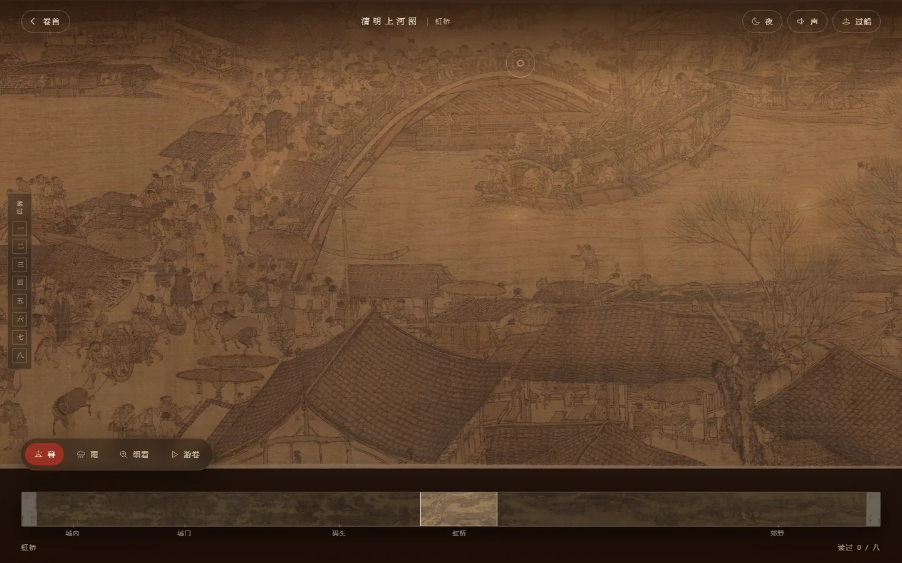
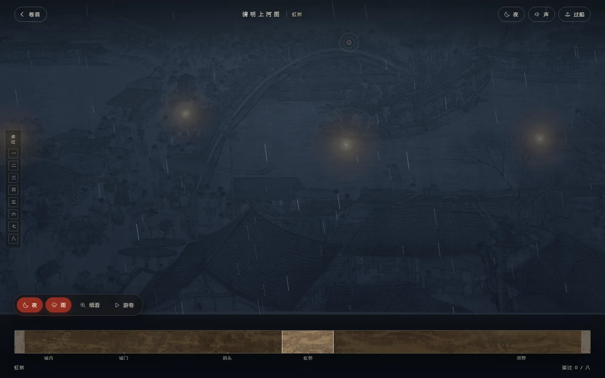

# 清明上河图 · 长卷入画

北宋张择端《清明上河图》的交互长卷。**自右向左展卷**：拖动观画、点景读题、八景收藏；「昼 / 暮 / 夜」三时光色、时雨、放大镜细看、自动游卷、画中人行走，另有「虹桥过船」五幕故事分镜。

参考了 <https://xianxie6.github.io/qingming-riverside/> 的交互思路，但交互与视觉全部重做，画卷直接使用公有领域的故宫博物院藏本高清扫描。








## 运行

零依赖。任选其一：

```bash
# 方式一：内置服务器（Node，推荐）
node server.mjs 8123     # → 本机 http://127.0.0.1:8123/ ；手机同 Wi-Fi 用打印的局域网地址

# 方式二：Python
python -m http.server 8123

# 方式三：直接双击 index.html
# （资源均为相对路径，多数浏览器可用；若入场动画不播放，请改用前两种）
```

**要让别人（外网）也能打开**：这是纯静态站点，把它放到 GitHub Pages / Netlify / Cloudflare Pages 即可，步骤见仓库根目录的 [`../DEPLOY.md`](../DEPLOY.md)。

## 交互

| 操作 | 效果 |
| --- | --- |
| 拖动 / 单指滑动 | 展卷（带惯性） |
| 滚轮、触控板 | 左右展卷；`Ctrl + 滚轮` 缩放 |
| `←` `→` | 展卷；`↑` `↓` 在缩放后上下移动 |
| `+` `-` | 缩放；双击画面亦可放大 / 复位 |
| 点击画中红点 | 拉近并打开「题签」 |
| 底部缩略图 | 点击或拖动定位；五个地名可直达 |
| **光** | 「昼 / 暮 / 夜」三态循环：天光、暮色、月色灯火 |
| **雨** | 时雨：粒子雨脚 + 湿润冷调 + 雨声层 |
| **活** | 活画：把画里挑担的脚夫单独抠出来，他在原地小幅走动——动的是原画的墨迹，不是另画的剪影 |
| **细看** | 画眼放大镜：跟随指针 2.2 倍，直接取原扫描像素重绘 |
| **游卷** | 自动展卷约 70 秒，逐景浮出题名，任意操作即暂停 |
| **入画** | 走进街市：插画场景 + 画师主角，`←` `→` / 拖动前行；靠近茶棚、门楼、铺面按 <kbd>E</kbd> 触发小场景（茶烟、门灯、店灯），主角会自动转向该处 |
| **过船** | 打开「虹桥过船」五幕故事，镜头自动推移 |
| 「声」 | WebAudio 合成的汴河水声 + 雨声（默认关闭） |
| 左侧印章 | 已读八景，可直接跳转；**八景读毕弹出「阅画记」** |
| 题签「复制」 | 复制当前景的深链（`#s=N`） |
| `Esc` | 依次收起阅毕卡 / 故事 / 题签 / 回到卷首 |

渐进的细节：题签按展卷方向编号（一 → 八，自卷首郊野到卷末街市），读过的景会在左侧留下朱印；题签的竖排书签、印章、纸纹共同撑起「在画上题字」的观感。

## 目录

```
index.html            结构
src/style.css         视觉系统（绢色、纸纹、印、题签、夜景、响应式）
src/app.js            相机 / 拖动惯性 / 缩放 / 分块加载 / 故事 / 音频
server.mjs            零依赖静态服务器
assets/scroll/t00..11.webp   长卷切片（1959×1100，共 12 块）
assets/cover.webp     卷首预览（虹桥段）
assets/mini.webp      缩略图
```

## 实现要点

- **分块长卷**：原扫描 38414×1800，裁去装裱边后等比缩至高 1100、切成 12 张 WebP；页面按「当前视口 ± 0.9 屏」按需挂载 `background-image`，首屏只解 3–4 张，避免一次性解码上百 MB。
- **相机模型**：`translate3d(-x,-y,0) scale(s)`（`transform-origin:0 0`），位移量以屏幕像素计；`x ∈ [0, trackW·s − stageW]`，缩放围绕指针位置换算，热点的 `--inv` 反向缩放保证屏幕尺寸恒定。
- **惯性**：`pointermove` 采样速度，抬起后按 0.93 衰减到 < 0.25px/帧；`prefers-reduced-motion` 下全部关闭。
- **故事镜头**：五幕各有 `{u, v, scale}`，`easeInOutCubic` 插值飞行，焦点圆环随相机反向缩放；故事开启时禁用拖动，避免与镜头抢夺。
- **夜景 / 暮色**：像素级滤镜（`brightness/saturate/hue-rotate/sepia`）把画卷整体压成冷调或夕照，再叠加坐标绑定画卷的灯火层，`mix-blend-mode: screen` 提亮——所以灯火会跟着画卷一起移动、缩放。
- **画眼**：不用 DOM 缩放，而是按「指针 → 画卷源像素」换算，直接 `drawImage` 原扫描的对应区域到 canvas（2.2×），跨切片时逐张拼接，因此放大后仍是原始笔触，不是拉伸的模糊图。
- **时雨**：独立 canvas 粒子（雨脚速度/长度/透明度分三档），叠加湿润滤色层；雨声是 WebAudio 白噪声经 bandpass 后单独一路增益，与河水声互不干扰。
- **自动展卷**：rAF 匀速推进 `cam.x`，按「中心 u 与景点的距离」触发字幕；任何拖动 / 滚轮 / 方向键 / 缩略图操作立即暂停，不与手动争夺控制权。
- **入画（漫步场景）**：街市这一幕用的是插画场景（`assets/walk/courtyard.webp`，作者授权使用），不是原扫描——单张平铺的画卷做不出可以走进去的空间。相机做呼吸式微推拉 + 行走位移，叠雾带、浮尘、河面水光；三个地点用画面比例定位，靠近才浮出互动提示，触发时在对应位置生成茶烟、门灯、店灯。
- **无障碍**：热点为 44px 按钮、缩略图为 `role="slider"` + 方向键、题签与阅毕卡同步 `aria-hidden`、全站键盘可达、动效尊重减少动态偏好。
- **深链**：`#view` 入画、`#story=2` 第三幕、`#s=4` 第五景、`#dusk` / `#night` / `#rain` / `#loupe` / `#tour` 直达状态，`?snap` 关闭动效（截图与自动化用）。

## 素材与许可

- 画卷：《清明上河图》北宋 张择端，故宫博物院藏本，[公有领域扫描（Wikimedia Commons）](https://commons.wikimedia.org/wiki/File:Alongtheriver_QingMing.jpg)。
- 切片与派生图由 `Pillow` 生成，可自由使用。
- 题签文字为本项目撰写，参考故宫博物院与通行研究对画卷内容的描述；如需引用请核对原文。
